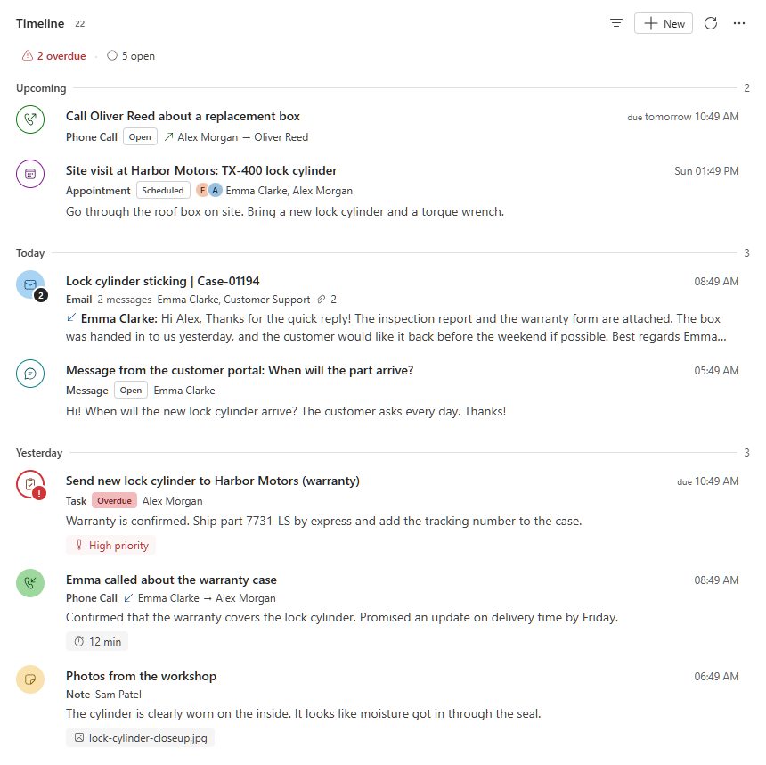
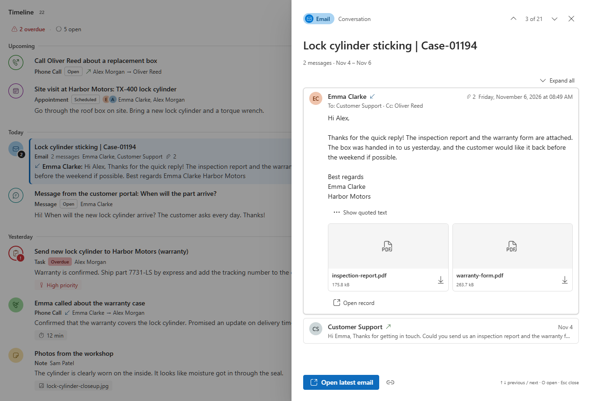

# Activity Timeline

A free, open-source replacement for the timeline on model-driven forms in Dynamics 365 and Power Apps. Put it on
any table that has activities or notes. Users see what's overdue and what's coming up, read emails as
conversations, and preview any activity without leaving the form.



- **Each activity at the date that matters:** meetings when they're held, tasks and calls by due date (completion
  date once done), everything else when it was created.
- **Upcoming section** on top: open meetings, tasks and calls still ahead, soonest first.
- **Email conversations:** replies and forwards are grouped into one card. Opening it shows the whole thread,
  newest first, with quoted text hidden.
- **Preview panel** built around the content: the title, the one date that matters, who it's between, the
  description and attachments. Owner, priority and other columns sit in a small *Details* list at the bottom. Step
  through items with ↑ ↓.
- **Clear status:** typed, coloured icons; overdue items are marked red and counted in a one-line summary that
  filters the feed when clicked.
- **Filters on demand:** search, activity types with counts, status, date, "Only mine" and an activity-per-week
  chart. They stay hidden until the user opens them.
- **Fast on busy records:** loads 20 items at a time and the next 20 as the user scrolls.
- **English, Norwegian and Swedish**, following each user's language in Dataverse.

Everything shown is data from Dataverse; nothing is generated or summarised.



*The screenshots show made-up sample data.*

## Requirements

- Dataverse online: Dynamics 365 or Power Apps model-driven apps. Not supported on-premises, in canvas apps or in
  Power Pages.
- Permission to import solutions and edit forms in the environment (System Customizer or System Administrator).

## Install

1. Download [ActivityTimeline.zip](https://github.com/thomassandsor/activity-timeline-pcf/releases/latest/download/ActivityTimeline.zip) from the [latest release](../../releases/latest).
2. In [Power Apps](https://make.powerapps.com), pick your environment, then go to **Solutions → Import solution**.
3. Choose the file and select **Import**.
4. When the import is done, select **Publish all customizations**.

To update, import a newer `ActivityTimeline.zip` the same way and publish.

To remove it:
1. Take the control off your forms.
2. Open the **Activity Timeline** solution, select the control and choose **Delete from this environment**.
3. Delete the solution. Deleting the solution alone leaves the control behind.

`ActivityTimeline.zip` is an unmanaged solution. Each release also has `ActivityTimeline_managed.zip`, if you'd
rather install it as managed, for example in test and production. Then deleting the solution removes the control
too.

## Add it to a form

The control needs a column to sit on. It never reads or writes that column, so a dedicated text column works best.

1. In your table, add a **single line of text** column, for example *Timeline* (`new_timeline`).
2. Open the table's main form in the form designer. Add the *Timeline* column where the timeline should appear,
   typically in its own section in place of the built-in timeline.
3. With the column selected, tick **Hide label**. The control draws its own title row.
4. Under **Components**, select **+ Component**, choose **Activity Timeline**, set the properties (see below) and
   select **Done**.
5. Optionally remove the built-in *Timeline* from the form.
6. **Save and publish**, then reload the app. Browsers cache controls, so a second reload may be needed after
   an update.

Which activities appear:

- **Regarding:** activities whose *Regarding* is the record, on any table with activities enabled.
- **Participant:** with *Related activities* set to *Regarding or participant* (the default), also activities
  where the record is a sender, recipient or attendee. This is useful on contacts and accounts.
- **Notes:** notes and their files, on tables with notes enabled.

## Settings

| Setting | Default | What it does |
|---|---|---|
| Activity types | `email,phonecall,task,appointment` | Activity tables to show, by logical name, comma-separated. `*` shows every activity type. Custom activities work too, e.g. `new_message` |
| Show notes | Yes | Shows notes and their files, and lets users write notes from the **New** menu |
| Related activities | Regarding or participant | *Regarding the record*, or also activities where the record is a sender, recipient or attendee |
| Sort by | Activity date | The date each activity is placed by. *Activity date* uses the date that matters per type (see [Where items appear](#where-items-appear)). The other choices use one column for every type, like the built-in timeline: Created on, Last updated, Actual end, Due date, Start date, Date sent or Sort date |
| Sort notes by | Last updated | Used when sorting by a single column: Created on or Last updated. With *Activity date*, notes use Created on |
| Default sort order | Newest first | Users can switch |
| Types users can create | `email,phonecall,task,appointment` | Activity types in the **New** menu. They open the quick create form (the full form for email) with the record filled in. Leave empty to hide the menu |
| Items per page | 20 | 5–100. Older items load as the user scrolls |
| Height (px) | 0 | 0: the timeline grows with its content and the page scrolls, like the built-in timeline. A number gives a fixed height with its own scroll |
| Default density | Comfortable | *Comfortable* shows a preview of each item's content; *Compact* shows one line per item. Users can switch |
| Show overview | Yes | Shows the summary line and the activity-per-week chart |
| Group email conversations | Yes | Shows replies and forwards with the same subject as one conversation |
| Advanced configuration (JSON) | (empty) | Optional fine-tuning; see below |

### Advanced configuration

All keys are optional:

```json
{
  "previewColumns": {
    "task": ["prioritycode", "percentcomplete", "ownerid", "category"],
    "new_message": ["new_channel", "ownerid"]
  },
  "typeStyles": {
    "new_message": { "color": "teal", "icon": "chat", "label": "Message" }
  },
  "dateRules": {
    "new_servicevisit": "start"
  },
  "defaultFilters": { "status": "open", "onlyMine": false },
  "rhythmWeeks": 12,
  "hideNoteComposer": false,
  "loadRemoteImages": false
}
```

| Key | What it does |
|---|---|
| `previewColumns` | Extra columns listed under *Details* in the preview, per table. Lookups, choices and dates are formatted with their Dataverse labels. Unknown columns are skipped |
| `typeStyles` | Colour, icon and label per table. `color`: `blue green marigold grape teal cranberry steel pumpkin lavender forest cornflower brown pink anchor`. `icon`: `mail call task calendar note service chat document person megaphone box wrench star receipt shield` |
| `dateRules` | Which date places a table's activities when sorting by activity date: `created`, `start`, `due` or `completed` (see below) |
| `defaultFilters` | Filters applied when the timeline opens: `types` (list of logical names), `status` (`all`, `open`, `overdue`, `completed`), `onlyMine` |
| `rhythmWeeks` | Weeks of history in the activity-per-week chart, 8–52. Default 12 |
| `hideNoteComposer` | Show notes but don't let users write them here |
| `loadRemoteImages` | Show remote images in emails without asking. Off by default, because remote images can track when an email is read |

If the JSON has a problem, the timeline shows a warning at the top explaining what to fix. Every user sees it, so
check the form before you publish.

## Where items appear

With **Sort by: Activity date** (the default), each activity is placed by the rule for its table:

| Rule | While open | Once completed or canceled | Default for |
|---|---|---|---|
| `start` | Start time | Start time | Appointments, service activities |
| `due` | Due date | Date it was completed | Tasks, phone calls, letters, faxes |
| `completed` | Created on | Date it was completed | (opt in per table) |
| `created` | Created on | Created on | Emails, notes, custom activities |

- An item without the date its rule needs, such as a task with no due date, falls back to Created on.
- With newest first, open meetings, tasks and calls whose date is still ahead go to the **Upcoming** section at the
  top, soonest first. Open items whose date has passed stay in the history and are marked overdue.
- Custom activities use `created` by default, because their completion dates are often set in bulk. Change that
  per table with `dateRules`.

Users can switch between the maker's choice, Activity date, Created and Last updated, and newest or oldest
first, from the **⋯** menu. Their choice is remembered per table.

## Using the timeline

- **Preview:** click an item to preview it. In the preview, **↑ ↓** (or **J K**) move to the previous or next
  item, **O** opens the record and **Esc** closes.
- **List:** **↑ ↓** move between items, **Enter** previews, **O** opens and **/** opens search and filters.
- **Quick actions:** hover an item to mark it complete or open it.
- **Notes:** **New → Note** writes a note inline, with an optional file; **Ctrl + Enter** saves.
- **New since your last visit:** a dot marks items others added since you last opened the record.

## Languages

The timeline shows English, Norwegian Bokmål or Swedish, following the language each user picks in Dataverse
(**Settings → Personal Options → Languages**). Users with another language get the organisation's base language
if it's one of these three, and English otherwise. Dates, times and numbers are formatted for the user's language,
in their Dataverse time zone.

Table and column names, status labels and choice values come from Dataverse, so they follow the environment's
own translations.

Want another language? Add a column to the table in `src/ActivityTimeline/scripts/strings.mjs` and open a pull
request (see [docs/DEVELOPMENT.md](docs/DEVELOPMENT.md)).

## Privacy and security

- **Data access:** everything is read and written through the Dataverse Web API with the signed-in user's own
  privileges. Users only see what they already have access to.
- **No outside calls:** the control calls no external services and sends no telemetry.
- **Writes:** it only writes when the user acts, by saving a note or marking an activity complete.
- **Email bodies:** shown in a sandboxed frame that can't run scripts. Remote images are blocked until the user
  chooses to show them.
- **Stored in the browser:** the user's view preferences per table (sort, density, filters) and the time they
  last opened each record. Both are kept in the browser's local storage.

## Performance

A first load sends about ten small requests:
- counts per activity type and status;
- one short query per kind of date;
- one query for the shown items' details.

The activity-per-week chart only loads when the filter panel is opened. Kinds of activities the record doesn't
have aren't queried.

## Known limitations

- Posts (Dynamics 365 only) aren't shown.
- Activities of an account's child contacts and opportunities aren't rolled up onto the account; participant
  matching covers the common contact and account cases.
- No reply or forward buttons yet; open the email to reply.
- Items can't be pinned to the top.
- So far it has been used mostly on case forms. If something looks wrong on another table, please
  [open an issue](../../issues).

## Build from source

See [docs/DEVELOPMENT.md](docs/DEVELOPMENT.md) for the project layout, a local test harness with sample data and
how releases are made.

## License

[MIT](LICENSE). Free to use, change and share, including commercially.
